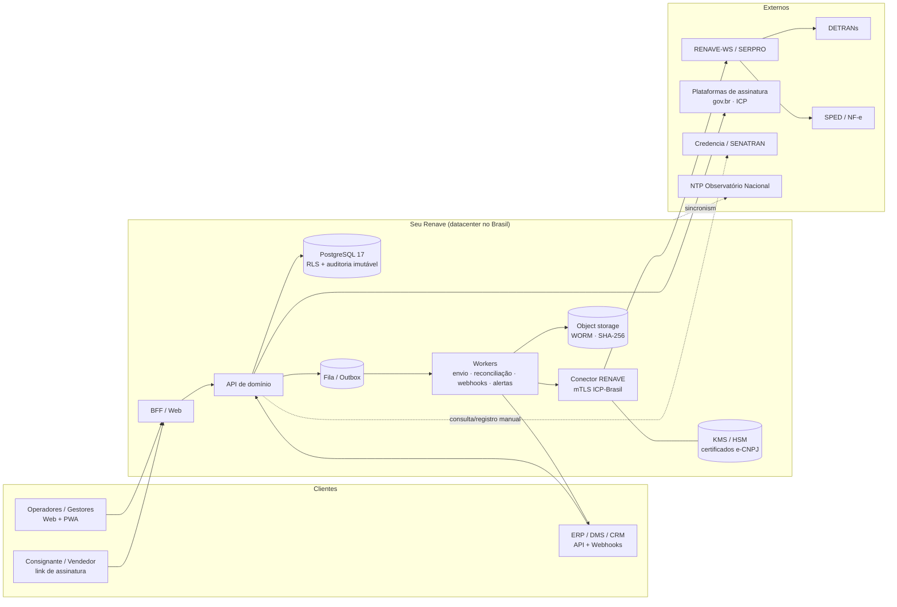
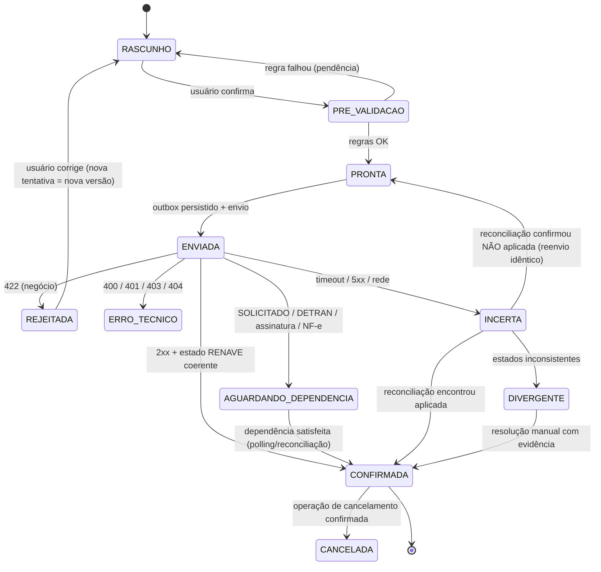
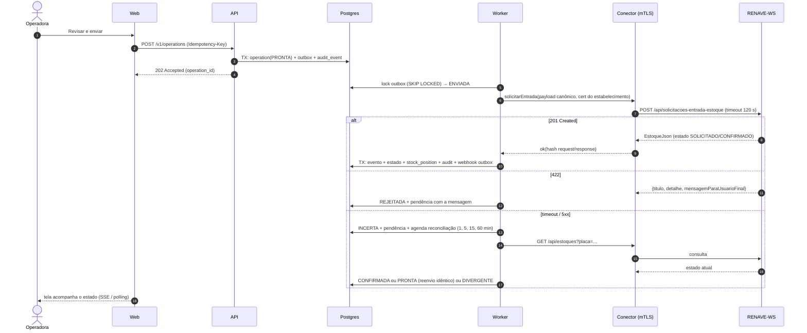
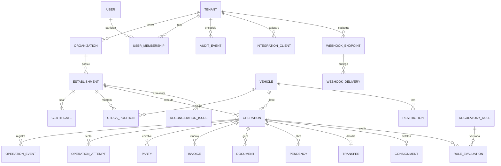

# 07 — Arquitetura, integração RENAVE e modelo de dados

## 7.1 Visão de contexto (C4 — nível 1)

## 7.2 Containers e responsabilidades (C4 — nível 2)

| Container | Responsabilidade | Tecnologia |
|---|---|---|
| **Web / PWA** | Portal do estabelecimento, assistentes, painéis, PWA do pátio | React 19, Vite, Tailwind 4, TanStack Query/Table, Radix |
| **Console** | Backoffice da integradora (tenants, saúde, reconciliação, Regulatory Watch) | Mesmo frontend, com rotas protegidas |
| **BFF** | Sessão OIDC (cookie httpOnly), proxy, CSRF, agregação para a UI | Fastify |
| **API de domínio** | Bounded contexts, regras, autorização, outbox | Fastify 5 + Prisma + SQL |
| **Workers** | Envio ao RENAVE, reconciliação, webhooks, alertas, relatórios, verificação de cadeia de hash | Node + BullMQ/pg-boss |
| **Conector RENAVE** (pacote) | mTLS por estabelecimento, serialização, timeouts, classificação de erro, catálogo de endpoints | `undici` + adapters versionados |
| **Identity** | OIDC, MFA, SSO federado | Keycloak |
| **Dados** | Postgres (RLS), Redis, S3 (object lock), KMS/HSM | Região Brasil |
| **Observabilidade** | Logs, métricas, traces, alertas, status page | OpenTelemetry, Grafana, Loki, Tempo, Prometheus |

## 7.3 Bounded contexts (módulos da API)

| Contexto | Agregados principais | Eventos publicados |
|---|---|---|
| `tenancy` | Tenant, Organization, Establishment, Contract | `establishment.activated`, `establishment.suspended` |
| `identity-access` | User, Role, Permission, ApiClient | `user.invited`, `access.changed` |
| `certificates` | Certificate | `certificate.expiring`, `certificate.revoked`, `certificate.rotated` |
| `vehicles` | Vehicle, VehicleSnapshot | `vehicle.restriction.detected` |
| `stock` | StockPosition, Operation, OperationEvent | `stock.entry.*`, `stock.exit.*`, `operation.*` |
| `transfers` | Transfer | `transfer.requested`, `transfer.completed` |
| `consignment` | ConsignmentContract | `consignment.signed`, `consignment.cancelled`, `consignment.deadline` |
| `documents` | Document, Invoice (NF-e), AtpvSignature, Dossier | `document.available`, `atpv.updated` |
| `compliance` | Pendency, ReconciliationIssue, RuleEvaluation, RegulatoryRule | `pendency.opened`, `reconciliation.divergence` |
| `audit` | AuditEvent (hash chain) | — |
| `integrations` | WebhookEndpoint, WebhookDelivery, ApiClient | — |
| `billing` | UsageRecord, PriceTable | — |

## 7.4 Máquina de estados da operação

A operação é a entidade central. **O estado do RENAVE não é guardado numa única coluna "status"**: cada operação tem eventos (`operation_event`) e o veículo tem uma posição de estoque (`stock_position`) derivada das operações confirmadas.

| Estado interno | Rótulo na UI | Cor |
|---|---|---|
| RASCUNHO | Rascunho | Neutro |
| PRE_VALIDACAO | Verificando | Info |
| PRONTA | Pronta para enviar | Info |
| ENVIADA | Enviada ao RENAVE | Info |
| AGUARDANDO_DEPENDENCIA | Aguardando (DETRAN / assinatura / NF-e) | Atenção |
| CONFIRMADA | Confirmada | Sucesso |
| REJEITADA | Recusada pelo RENAVE | Erro |
| ERRO_TECNICO | Erro técnico (integradora notificada) | Erro |
| INCERTA | Resultado incerto (verificando) | Atenção |
| DIVERGENTE | Divergência | Erro |
| CANCELADA | Cancelada | Neutro |

**Posição de estoque** (`stock_position.state`): `EM_ENTRADA` (RENAVE `SOLICITADO`) → `EM_ESTOQUE` (`CONFIRMADO`) → `VINCULADO` (restrição superveniente) → `EM_TRANSFERENCIA` → `BAIXADO` (`FINALIZADO`) / `TRANSFERIDO` (`TRANSFERIDO`) / `CONSIGNADO`.

## 7.5 Sequência — entrada de usado com idempotência e reconciliação

## 7.6 Catálogo RENAVE-WS × ações de negócio

**URLs base:**
- Produção: `https://renave.estaleiro.serpro.gov.br/renave-ws`
- Homologação: `https://hom.renave.estaleiro.serpro.gov.br/renave-ws`

**Contrato técnico:** Swagger 2.0 (Springfox), em `/renave-ws/v2/api-docs?group=<grupo>`. Grupos: Estabelecimento, ITE, Montadora e Detran; em homologação também os grupos "-Homologação".

**Fonte:** Swagger de produção e homologação, levantado em 23/11/2026. O catálogo é revalidado a cada release (RF-M19-03).

### 7.6.1 Estabelecimento (concessionária / revenda)

| Ação de negócio (UI) | Método e rota | Notas |
|---|---|---|
| Testar conexão / certificado | `GET /api/cliente-autenticado` | Primeiro teste após habilitar o certificado no Credencia |
| Consultar aptidão (entrada ou saída) | `GET /api/aptidao-veiculo-estoque?placa&renavam&tipoCrv&numeroCrv` | Diagnóstico com motivos, débitos, boletos do DETRAN e `comunicacaoComDetranFalhou` |
| Dar entrada — usado comprado | `POST /api/solicitacoes-entrada-estoque` | 201 → EstoqueJson |
| Dar entrada — veículo próprio | `POST /api/solicitacoes-entrada-estoque-veiculo-proprio` | Sem assinatura do vendedor |
| Enviar assinatura do vendedor (ATPV) | `POST /api/atpv-assinatura-vendedor` | Um tipo por envio; sobrescreve |
| Consultar assinatura do ATPV | `GET /api/atpv-assinaturas/{placa}/{renavam}/ultimo` | Tipos: próprio punho, P7S qualificado, avançada gov.br |
| Vincular NF-e (compra/venda) | `POST /api/notas-fiscais` | `evento` COMPRA ou VENDA (em homologação também CONSIGNACAO e DEVOLUCAO) |
| Vender veículo (saída de usado) | `POST /api/solicitacoes-saida-estoque` | Comprador com endereço e `codigoMunicipio` |
| Cancelar entrada | `POST /api/solicitacoes-cancelamento-estoque` | Só com o estoque SOLICITADO |
| Cancelar saída | `POST /api/solicitacoes-cancelamento-saida-estoque` | Só antes da transferência no DETRAN |
| Enviar transferência (origem) | `POST /api/autorizacoes-transferencias` | CNPJ destino, placa, valor |
| Cancelar transferência enviada | `POST /api/cancelamentos-autorizacoes-transferencias` | Antes do aceite |
| Consultar transferências | `GET /api/autorizacoes-transferencias` | Filtros: placa, chassi, estado |
| Aceitar transferência (destino) | `POST /api/solicitacoes-transferencia-entre-estabelecimentos` | Consome a autorização |
| Transferir entre filiais | `POST /api/solicitacoes-transferencia-entre-filiais` | Sem autorização; já nasce CONFIRMADO |
| 0 km pendentes de entrada | `GET /api/veiculos-zero-km-pendentes-entrada-estoque?chassi` | Faturados para o CNPJ |
| Dar entrada 0 km | `POST /api/entradas-estoque-zero-km` | Hodômetro obrigatório |
| Cancelar entrada 0 km | `POST /api/cancelamentos-entrada-estoque-zero-km` | — |
| Vender 0 km | `POST /api/saidas-estoque-veiculo-zero-km` | — |
| Vender 0 km (Renovar) | `POST /api/saidas-estoque-veiculo-zero-km-renovar` | Não cancelável |
| Cancelar venda 0 km | `POST /api/cancelamentos-saida-estoque-zero-km` | — |
| Transferir 0 km (autorizar / cancelar / efetivar) | `POST /api/autorizacoes-transferencias-veiculo-zero-km`, `POST /api/cancelamentos-autorizacoes-transferencias-veiculo-zero-km`, `POST /api/transferencias-entre-estabelecimentos-veiculo-zero-km` | — |
| Devolver 0 km à montadora | `POST /api/devolucoes-montadora-veiculo-zero-km` | — |
| Rejeitar 0 km / cancelar rejeição | `POST /api/rejeicoes-zero-km`, `POST /api/cancelamentos-rejeicoes-veiculo-zero-km` | — |
| Entregas indicadas (consultar / realizar / cancelar) | `GET /api/entregas-veiculo-zero-km`, `POST …/realizacao`, `POST …/cancelamento` | Venda direta |
| Vender inacabado (normal / Renovar / cancelar) | `POST /api/saidas-estoque-veiculo-inacabado`, `…-renovar`, `POST /api/cancelamentos-saidas-estoque-veiculo-inacabado` | — |
| Enviar para ITE (autorizar / cancelar) | `POST /api/autorizacoes-transferencias-para-ite`, `POST /api/cancelamentos-autorizacoes-transferencias-para-ite` | — |
| Receber da ITE | `POST /api/transferencias-estoque-vindo-de-ite` | — |
| Consultar estoque | `GET /api/estoques` (placa, chassi, estadoEstoque, períodos), `GET /api/estoques/{id}` | Base da reconciliação. Sem filtro, retorna 3 meses |
| Consultar veículos em estoque | `GET /api/veiculos` | Só CONFIRMADO do próprio estoque |
| Termos de entrada / saída (PDF base64) | `GET /api/estoques/{id}/termo-entrada-estoque`, `GET /api/estoques/{id}/termo-saida-estoque` | O de saída "deve ser extinto" |
| PDF do ATPV-e (e XML para assinar) | `GET /api/pdf-atpv/{placa}/{renavam}`, `GET /api/pdf-atpv?chassi=` | — |
| CRLV-e / código de segurança do CRV | `GET /api/crlve/{placa}/{renavam}`, `GET …/pdf-codigo-seguranca-crv` | Exige NF de entrada e assinatura |
| Municípios | `GET /api/municipios?nome&uf`, `GET /api/municipios/{id}` | `codigoMunicipio` do comprador; manter cache |

### 7.6.2 ITE (`/api/ite/...`) e Montadora (`/api/montadora/...`)

| Perfil | Operações |
|---|---|
| **ITE** | entradas-estoque, cancelamentos-entrada-estoque-ite, transferencias-para-ite (TR 107/108, cliente-montadora), transferencias-vindo-de-ite-para-ite, autorizações/cancelamentos de estoque vindo de ITE, saidas-estoque (+ renovar), cancelamentos-saida-estoque-ite, clientes-montadoras?chassi, consultas (estoques, termos, veiculos, pdf-atpv, municipios, cliente-autenticado) |
| **Montadora** | entradas e cancelamentos de 0 km; saidas-estoque-veiculo-zero-km (+ renovar, com benefício tributário e entrega indicada); cancelamentos; inacabados (+ renovar); ITE (autorizar, cancelar, receber); consultas (pendentes, entregas, estoques, termos, veiculos, pdf-atpv, municipios) |

### 7.6.3 Homologação (mocks e consignação)

| Finalidade | Rota |
|---|---|
| Criar usado de teste (flags: roubo/furto, PGFN, pendência CRV, baixado etc.) | `POST /api/veiculos-usados-mock` |
| Simular transferência no DETRAN (leva a CONFIRMADO) | `POST /api/veiculos-usados-mock/transferencia-no-detran` |
| Criar 0 km de teste (`sufixoChassi`, inacabado) | `POST /api/veiculos-zero-km-mock`, `POST /api/montadora/veiculos-zero-km-mock` |
| Concluir inacabado na ITE (TR 107) | `POST /api/ite/veiculos-inacabados-mock/acabar` |
| Consignação: entrada e cancelamento | `POST /api/consignados/solicitacao-entrada`, `POST /api/consignados/cancelamento` |
| Consignação: mocks do DETRAN (TR 231/233/203/227/237) | `POST /api/veiculos-consignados-mock/*` |
| Clientes-padrão (sem certificado) | "Estabelecimento padrão de teste", "Zangão Acabador" (ITE), "Besoura Montadora" |

### 7.6.4 Convenções técnicas do RENAVE-WS

| Tema | Regra |
|---|---|
| Autenticação | **TLS mútuo** com o certificado do cliente cadastrado no Credencia (serial, CN, emissor); truststore com a AC SERPRO; não há cabeçalho de autenticação |
| Identidade do operador | `cpfOperadorResponsavel` no corpo, então todo usuário operador precisa de **CPF cadastrado** |
| Datas | `AAAA-MM-DD` (date) e `AAAA-MM-DDTHH:MM:SS` (date-time) |
| Respostas | 200/201 sucesso · 400 bug do integrador · 401/403 · 404 · **422 negócio** · 500 interno |
| Erro | `{ titulo, dataHora, detalhe, mensagemParaUsuarioFinal, logIdRastreabilidade }` |
| Timeouts sugeridos | POST 2 min · GET 1 min |
| Idempotência do RENAVE | Um reenvio idêntico converge o estado após erro interno |
| Versionamento | **Sem versão na URL**; campos obsoletos podem ser removidos "sem aviso" → testes de contrato diários contra o Swagger |
| Paginação | Inexistente; listas filtradas |

### 7.6.5 Capacidades sem endpoint (adapters reservados)

`identificacao-previa`, `vistoria`, `estoque-vinculado`, `retomado-nsu`, `termo-entrega-entrada`, `termo-entrega-saida`, `contrato-consignacao`, `placa-experiencia`, `reforma-recuperacao`. Cada uma tem uma **interface de domínio** definida, uma implementação "local/evidência" e uma **feature flag** por data de vigência (RF-M19-07).

## 7.7 Modelo de dados

> Convenções: UUIDv7 como PK; `tenant_id` em toda tabela de tenant (com RLS); `created_at` e `updated_at` em UTC; `jsonb` para estruturas; documentos endereçados por SHA-256; tabelas de evento **append-only**.

### Entidades e campos principais

| Entidade | Campos principais | Observações |
|---|---|---|
| **tenant** | id, nome, status (ACTIVE / SUSPENDED / CLOSED), conta de faturamento, região | Cliente lógico |
| **organization** | id, tenant_id, razão social, raiz CNPJ | Grupo econômico |
| **establishment** | id, tenant_id, organization_id, cnpj (alfanumérico), tipo (REVENDA / CONCESSIONARIA / MONTADORA / ITE / CREDORA), matriz_id, uf, cod_municipio_renave, email_renave, cnae_principal, adesao_status, adesao_protocolo, adesao_datas, ambiente_ativo, bloqueio_motivo | Trigger de DV e raiz |
| **certificate** | id, tenant_id, establishment_id, ambiente, kms_key_ref, serial, subject_cn, issuer_cn, thumbprint_sha256, not_before, not_after, status, revocation_checked_at | **Nunca** a chave |
| **user** / **user_membership** | id, nome, e-mail, **cpf** (obrigatório para operador), mfa; membership: tenant_id, role, escopo de estabelecimentos | O CPF vai no `cpfOperadorResponsavel` |
| **vehicle** | id, tenant_id, chassi, renavam, placa, uf_placa, marca, modelo, versao, ano_fab, ano_mod, cor, combustivel, especie, tipo, categoria, tipo_crv, numero_crv, **codigo_seguranca_crv (cifrado)**, inacabado | Identidade por chassi |
| **vehicle_snapshot** | id, vehicle_id, fonte, payload_ref, sha256, consultado_em | Aptidão e consultas |
| **stock_position** | id, tenant_id, establishment_id, vehicle_id, state, renave_id_estoque, renave_estado, entrada_em, saida_em, hodometro, hodometro_em, valor_entrada, tipo (USADO / ZERO_KM / CONSIGNADO / RETOMADO) | Única ativa por veículo (índice parcial) |
| **operation** | id, tenant_id, establishment_id, vehicle_id, tipo (ENTRADA_COMPRA, ENTRADA_PROPRIO, SAIDA_VENDA, ENTRADA_0KM, SAIDA_0KM, TRANSF_AUTORIZAR, TRANSF_ACEITAR, TRANSF_FILIAL, CANCEL_*, NFE_VINCULAR, ATPV_ASSINATURA, CONSIG_*, ITE_*, …), titulo_negocio, estado, idempotency_key (unique por tenant), payload_canonico (jsonb), payload_sha256, certificate_id, correlation_id, criado_por, versao | Núcleo |
| **operation_attempt** | id, operation_id, n, enviado_em, http_status, renave_erro (titulo, detalhe, mensagemUsuario, logId), request_sha256, response_sha256, response_ref, latencia_ms, classificacao (OK / NEGOCIO / TECNICO / INCERTO) | Cada chamada |
| **operation_event** | id, operation_id, de, para, motivo, ator, ocorrido_em | Append-only |
| **party** | id, tenant_id, tipo (PF/PJ), documento (cifrado + hash para busca), nome, e-mail, telefone, endereço, cod_municipio | Vendedor, comprador, consignante, credora |
| **invoice** (NF-e) | id, tenant_id, operation_id, chave (44, unique por tenant), numero, serie, emitente_doc, destinatario_doc, data_emissao, valor, cfop, evento (COMPRA / VENDA / CONSIGNACAO / DEVOLUCAO), xml_ref, sha256, status_sped | Unique impede reuso |
| **atpv_signature** | id, operation_id, tipo_assinatura, assinado_em, arquivo_ref, sha256, status | Acompanhamento |
| **document** | id, tenant_id, owner (operation/vehicle), tipo (ATPVE, CRLVE, TERMO_ENTRADA, TERMO_SAIDA, CONTRATO_CONSIG, IDENT_PREVIA, VISTORIA_FOTO, NFE_XML, DOSSIE…), versao, storage_key (sha256/aa/bb/…), sha256, mime, tamanho, origem, retencao_ate | Imutável (nova versão = nova linha) |
| **restriction** | id, vehicle_id, tipo, origem, descricao, impeditiva, detectada_em, resolvida_em | Gera VINCULADO |
| **transfer** | id, operation_id, origem_estab, destino_cnpj, valor, estado, autorizado_em, aceito_em, prazo | — |
| **consignment** | id, operation_id, consignante_party_id, modelo_versao, campos (jsonb), assinatura_estab_em, assinatura_consig_em, venda_iniciada_em, prazo_atpv_em, cancelado_em, cancelado_por, nfe_devolucao_id | Prazo de 30 dias |
| **pendency** | id, tenant_id, establishment_id, vehicle_id, operation_id, categoria, causa, impacto, proxima_acao, responsavel_id, prazo, risco, estado (ABERTA / RESOLVIDA / DESCARTADA), causa_externa_evidencia | Fila |
| **reconciliation_issue** | id, tenant_id, establishment_id, tipo (ESTOQUE, NFE, DOCUMENTO, TRANSFERENCIA, CERTIFICADO, OPERACAO), local_estado, renave_estado, evidencia_ref, estado, resolvido_por | Bloqueia repetição |
| **rule** / **rule_version** / **rule_evaluation** | expressão AST, hash, origem normativa (norma, artigo, manual, seção), vigência, aprovação; avaliação com facts_snapshot, trace e resultado (TRUE / FALSE / UNKNOWN) | Motor de regras |
| **audit_event** | event_id, tenant_id, establishment_id, actor_id/tipo, ip, user_agent, action, entity, entity_id, operation_id, vehicle_id, certificate_id, before/after (jsonb), request_sha256, response_sha256, result, correlation_id, occurred_at (UTC/HLB), previous_hash, event_hash | Append-only + cadeia de hash |
| **integration_client** | id, tenant_id, nome, client_id, secret_hash, scopes, rate_limit, expira_em | ERP/DMS |
| **webhook_endpoint** / **webhook_delivery** | url, secret_ref, eventos, status; entrega: event_id, tentativa, status_http, latencia, proxima_tentativa | Assinados |
| **regulatory_change** | id, fonte (DOU / Portaria / Manual), referência, publicado_em, vigencia_em, impacto, status, flags | Regulatory Watch |
| **usage_record** / **price_table** | tenant, estabelecimento, tipo de operação, quantidade, mês; preço dentro da faixa SENATRAN | Cobrança |

## 7.8 API externa (para ERP/DMS) — visão geral

Base: `https://api.<dominio>/v1` · Auth: OAuth2 client credentials (ou mTLS) · `Idempotency-Key` obrigatória em POST · `X-Correlation-Id` propagado.

| Método | Rota | Finalidade |
|---|---|---|
| GET | `/vehicles/{chassi\|placa}` | Ficha agregada e posição de estoque |
| GET | `/vehicles/{id}/eligibility?purpose=entry\|exit` | Aptidão e pré-condições (com trace) |
| POST | `/operations/stock-entries` | Entrada (usado comprado / próprio / 0 km) |
| POST | `/operations/stock-exits` | Saída (venda usado / 0 km) |
| POST | `/operations/transfers` | Enviar transferência ou transferir entre filiais |
| POST | `/operations/transfers/{id}/accept` | Aceitar a transferência recebida |
| POST | `/operations/{id}/cancel` | Cancelar quando permitido |
| GET | `/operations/{id}` | Estado da operação (eventos, tentativas, pendências) |
| POST | `/invoices` | Registrar/vincular NF-e (chave e/ou XML) |
| POST | `/atpv-signatures` | Enviar assinatura do vendedor |
| GET | `/documents/{id}` · `/operations/{id}/dossier` | Documento e dossiê |
| GET | `/stock?establishment=&state=&age=` | Estoque |
| GET | `/pendencies` | Pendências abertas |

**Webhooks** (assinatura `X-Signature: t=<ts>,v1=<hmac-sha256>`): `renave.stock.entry.confirmed`, `renave.stock.exit.confirmed`, `renave.transfer.requested`, `renave.transfer.completed`, `renave.document.available`, `renave.atpv.updated`, `renave.restriction.detected`, `renave.operation.pending`, `renave.operation.failed`, `renave.operation.uncertain`, `renave.reconciliation.divergence`, `renave.certificate.expiring`, `renave.consignment.deadline`.

## 7.9 Segurança do certificado (detalhe)

> ⚠️ **Atualização (23/11/2026, doc 14):** no **novo modelo** publicado em homologação, a integradora acessa o RENAVE-WS com **o seu próprio e-CNPJ** (conexão única) e identifica a loja pelo cabeçalho **`CNPJ-Estabelecimento`**. A loja autoriza pelo **vínculo no Credencia** (procuração eletrônica) e **não entrega mais o certificado**. As regras abaixo sobre certificado **por estabelecimento** valem para o **modo legado/fallback** (flag `ESTABELECIMENTO`). No modo padrão (`INTEGRADORA`), aplicam-se ao **certificado da integradora** (RN-INT-SRP-05) e ao **vínculo Credencia** (RN-INT-SRP-02/03).

No modo padrão, o *cert-service* guarda **o certificado da integradora** (2 válidos, rotação escalonada) e o fluxo descrito abaixo vale para ele. A importação de certificados de estabelecimentos fica restrita ao modo legado. Detalhes em `14-integracao-serpro.md` §14.2.

1. O upload do PFX é feito **direto para um serviço isolado** (`cert-service`), que importa a chave para o **KMS/HSM** (A1) ou registra a referência ao HSM de rede (A3).
2. O PFX original é descartado com eliminação segura; a senha nunca é persistida.
3. O conector obtém um **handle** da chave em tempo de execução para o handshake TLS. Opções: chave não exportável via `PKCS#11` (HSM) ou *sidecar* de mTLS que termina o TLS de saída com a chave no HSM.
4. O certificado e a cadeia ficam no banco; a chave privada nunca sai do cofre.
5. Rotação: novo certificado → `GET /api/cliente-autenticado` em teste → ativação → aposentadoria do anterior.

## 7.10 Ambientes

| Ambiente | Uso | RENAVE | Dados |
|---|---|---|---|
| DEV | Desenvolvimento | Mock local (WireMock/Prism a partir do Swagger) | Sintéticos |
| HML | Homologação SERPRO / testes integrados | `hom.renave…` + clientes-padrão e mocks | Sintéticos |
| STG | Pré-produção, ensaio de release | `hom.renave…` | Cópia anonimizada |
| PRD | Produção | `renave…` | Reais |
