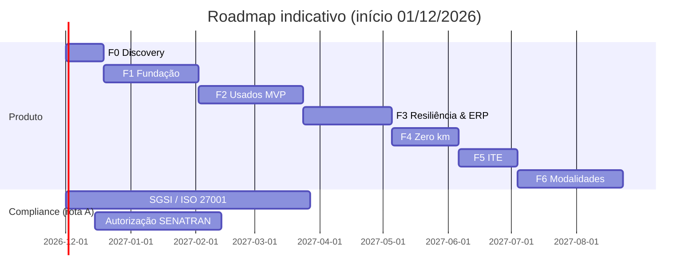

# 09 — Roadmap, homologação, riscos e decisões

## 9.1 Roadmap por fases

> Durações estimadas para um time de **4 devs full-stack + 1 tech lead + 1 designer + 1 QA + 1 PO**, considerando o reuso descrito em `02-analise-de-reuso.md`. Faixas de ordem de grandeza, a refinar na Fase 0.

| Fase | Escopo | Saída esperada | Duração |
|---|---|---|---|
| **F0 — Discovery regulatório e decisão de modelo** | Ler a Circular SENATRAN 2/2026 e a Res. 1.027/2026; consultar a SENATRAN sobre os procedimentos de autorização e homologação de integradora; decidir entre rota A (integradora própria) e B (parceria); certificado e-CNPJ de homologação; acesso a `hom.renave`; validar a arquitetura | Backlog validado, decisão de modelo de negócio, arquitetura aprovada (ADRs) | 2–3 sem. |
| **F1 — Fundação** | Monorepo, CI/CD, IaC em região Brasil, tenancy + RLS, Keycloak + MFA, RBAC, auditoria com cadeia de hash + NTP, cofre de certificados, **conector RENAVE** (mTLS, catálogo, classificação de erro), outbox/fila, observabilidade, design system | Base segura e homologável; `GET /cliente-autenticado` funcionando com certificado de cliente | 6–7 sem. |
| **F2 — Usados MVP** | Consulta e aptidão, entrada (compra e próprio), assinatura do vendedor, NF-e, saída, cancelamentos, termos, ATPV-e e CRLV-e, pendências, reconciliação de incertos, painel, auditoria, onboarding guiado | Fluxo ponta a ponta de revenda homologado; **piloto com 3–5 revendas** | 6–8 sem. |
| **F3 — Resiliência e ERP** | Reconciliação periódica, transferências (estabelecimentos e filiais), API pública v1 + webhooks + sandbox, importação de NF-e, dossiê exportável, portabilidade, console da integradora, cobrança e medição | Operação estável e integrada; parceiros DMS conectados | 6 sem. |
| **F4 — Zero km** | Pendentes, entrada em lote, saída, Renovar, entregas, devolução e rejeição, transferência 0 km | Concessionárias atendidas | 4–5 sem. |
| **F5 — ITE e inacabados** | Fluxos ITE e de inacabados, perfil montadora (venda direta) | Cobertura industrial | 4 sem. |
| **F6 — Modalidades avançadas** | Consignação (contrato, assinaturas, 30 dias), retomados e credoras, estoque vinculado, sucessão e falência, portal de fiscalização — conforme a publicação dos endpoints | Cobertura total da Res. 1.026 | 6–8 sem. (depende da SERPRO) |
| **F7 — Inteligência operacional** | Previsão de pendências, antifraude avançado, copiloto de suporte, Regulatory Watch automatizado, BI | Diferenciação | Contínuo |

**Trilha paralela — Compliance da integradora (se rota A):** SGSI e ISO 27001 (escopo, análise de risco, SoA, políticas, controles, auditoria interna, certificação) até **27/03/2027**; programa de integridade; política de privacidade; DPA; plano de continuidade com teste de RTO ≤ 4 h; documentação para a SENATRAN.

> ⚠️ **O MVP de usados (fim da F2) cai em ~abr/2027, depois do prazo de ISO 27001 (27/03/2027).** Na rota A, a certificação precisa começar **imediatamente** e correr em paralelo; o escopo do SGSI pode cobrir primeiro a infraestrutura e os processos, antes de o produto estar completo.

## 9.2 Plano de homologação e testes

### Ciclo

1. Credenciamento e autorização (Credencia).
2. Contrato e acesso.
3. Certificado e mTLS (`GET /api/cliente-autenticado`).
4. Sandbox e mocks.
5. Testes funcionais.
6. Testes negativos.
7. Ponta a ponta com o DETRAN (veículo criado pelo DETRAN a pedido).
8. Evidências de homologação.
9. Go-live controlado.
10. Monitoramento.
11. Reconciliação.
12. Gestão de mudanças.

### Matriz de cenários mínimos (homologação)

| # | Cenário | Tipo | Como provocar |
|---|---|---|---|
| H-01 | Entrada de usado comprado de PF → assinatura P7S → NF-e → CONFIRMADO | Positivo | `veiculos-usados-mock` + `transferencia-no-detran` |
| H-02 | Entrada de veículo próprio | Positivo | Mock |
| H-03 | Saída de usado → ATPV-e → FINALIZADO | Positivo | Mock |
| H-04 | Aptidão com roubo/furto | Negativo | Mock `comRouboFurto` |
| H-05 | Aptidão com restrição PGFN | Negativo | Mock `comRestricaoPgfn` |
| H-06 | Pendência de emissão de CRV | Negativo | Mock `comPendenciaEmissaoCrv` |
| H-07 | Veículo já baixado | Negativo | Mock `jaBaixado` |
| H-08 | Vendedor ≠ proprietário do CRV (422) | Negativo | Payload |
| H-09 | NF-e com chave inválida (422) | Negativo | Payload |
| H-10 | Cancelar entrada em SOLICITADO / tentar em CONFIRMADO (422) | Positivo / negativo | Mock |
| H-11 | Cancelar saída antes da transferência no DETRAN | Positivo | Mock |
| H-12 | Transferência entre estabelecimentos (autorizar → cancelar → autorizar → aceitar) | Positivo | Dois clientes-padrão |
| H-13 | Transferência entre filiais | Positivo | Mesma raiz |
| H-14 | 0 km: pendente → entrada → saída → entrega | Positivo | `veiculos-zero-km-mock` |
| H-15 | 0 km Renovar (não cancelável) | Positivo / negativo | Mock |
| H-16 | Inacabado → ITE → acabar (TR 107) → saída | Positivo | `ite/veiculos-inacabados-mock/acabar` |
| H-17 | Consignação: entrada e cancelamento + mocks de DETRAN | Positivo | `/api/consignados/*` |
| H-18 | Timeout simulado → INCERTA → reconciliação → CONFIRMADA sem duplicar | Resiliência | Proxy de falhas (toxiproxy) |
| H-19 | 500 com `logIdRastreabilidade` → reenvio idêntico converge | Resiliência | Injeção |
| H-20 | Certificado expirado / revogado → bloqueio local | Segurança | Certificado de teste |
| H-21 | Usuário do tenant A tenta ler o veículo do tenant B → 404 | Segurança | Suíte de isolamento |
| H-22 | Webhook com falha → retry → pausa → reenvio manual | Integração | Endpoint de teste |
| H-23 | Verificação da cadeia de hash após adulteração simulada → alerta | Auditoria | Script |
| H-24 | DR: restore + failover dentro do RTO | Continuidade | Game day |

### Cobertura de testes por camada

| Camada | Cenários |
|---|---|
| Unitário | Regras (motor AST), validações BR, transições de estado, permissões, canonicalização e hash |
| Contrato | Snapshot do Swagger RENAVE (diário); OpenAPI público; JSON Schemas dos webhooks |
| Integração | mTLS, certificados, timeouts, retries, classificação de erros (padrão de testes do `detran_gateway`) |
| Homologação | H-01..H-17 |
| E2E | ERP → plataforma → RENAVE → retorno → documentos → webhook (Playwright + API) |
| Segurança | SAST, DAST, *secret scan*, isolamento multi-tenant, abuso de API, pentest |
| Resiliência | Queda de rede, duplicidade, *replay*, retry, fila, reconciliação |
| Usabilidade | 5 usuários por persona, tarefas J2/J3/J8; SUS ≥ 80 |

## 9.3 Checklist de prontidão (go-live)

| Área | Critério | ✅ |
|---|---|---|
| Governança | Responsável regulatório e responsável técnico de segurança nomeados; processo de mudança documentado | ☐ |
| Modelo | Autorização de integradora (rota A) ou contrato de parceria validado (rota B) | ☐ |
| Acesso | Credenciamento/contratação e ambientes HML e PRD disponíveis | ☐ |
| Certificados | mTLS testado; rotação e alertas ativos; cofre em produção | ☐ |
| Domínio | Estados de veículo, estoque e operação modelados e testados | ☐ |
| Usados | Entrada e saída ponta a ponta homologadas (H-01..H-11) | ☐ |
| Fiscal | NF-e integrada e validada | ☐ |
| Documentos | ATPV-e, CRLV-e e termos guardados com hash e controle de acesso | ☐ |
| Segurança | RBAC, MFA, cofre, criptografia, isolamento, pentest sem achados críticos | ☐ |
| Auditoria | Eventos completos, cadeia de hash verificada, NTP do ON, retenção WORM 5 anos | ☐ |
| Resiliência | Idempotência, timeout, retry e reconciliação testados (H-18, H-19) | ☐ |
| Observabilidade | Dashboards, alertas, tracing e runbooks ativos | ☐ |
| Integrações | API e webhooks versionados e documentados | ☐ |
| Continuidade | DR testado com RTO ≤ 4 h; backup restaurado | ☐ |
| Operação | Suporte em horário ampliado, SLA, incidentes e mudanças definidos | ☐ |
| LGPD | RoPA, retenção, minimização, DPA e política publicada | ☐ |
| Comercial | Tabela de preços pública dentro da faixa SENATRAN; plano RENAVE isolado | ☐ |
| Usabilidade | Teste com usuários; SUS ≥ 80 | ☐ |

## 9.4 Riscos

| # | Risco | Prob. | Impacto | Mitigação |
|---|---|---|---|---|
| R1 | **Não obter a ISO 27001 até 27/03/2027** (rota A) | Alta | Crítico | Iniciar já; consultoria; escopo inicial enxuto; pedido de dilação com evidência de início antecipado (previsto no Anexo); rota B como plano de contingência |
| R2 | **Requisito de capital (R$ 1 mi)** / vedações societárias | Média | Crítico | Estruturação societária; rota B; parecer jurídico sobre a vedação de DMS e de assinatura eletrônica, considerando o portfólio atual do grupo (despachante, pátio, ERP) |
| R3 | API RENAVE **atrás da norma** (sem endpoints para identificação prévia, vinculado, retomados, consignação) | Certa | Alto | Adapters + feature flags; capturar evidências localmente; Regulatory Watch |
| R4 | Mudanças de API **sem versionamento e sem aviso** | Alta | Alto | Testes de contrato diários contra o Swagger; alerta de diff; catálogo versionado |
| R5 | Cronograma regulatório (Circular 2/2026) **já em curso**; conformidade a partir de 20/11/2026 | Alta | Alto | F0 imediata; foco no MVP de usados; parcerias |
| R6 | Indisponibilidade do SERPRO/DETRAN gerando atraso de escrituração (multa com responsabilidade solidária) | Média | Alto | Evidência automática da causa externa; fila com reenvio seguro; comunicação proativa ao cliente |
| R7 | Duplicidade ou inconsistência por retry | Média | Alto | Idempotência + reconciliação obrigatória; bloqueio de repetição cega |
| R8 | Vazamento de chave privada / certificado | Baixa | Crítico | HSM/KMS; chave não exportável; revogação emergencial; monitoramento |
| R9 | Vazamento entre tenants | Baixa | Crítico | RLS FORCE + testes de isolamento no CI + pentest |
| R10 | Preço público SENATRAN que torne o modelo inviável | Média | Alto | Modelo de custos enxuto (automação, autoatendimento); receita complementar fora do escopo RENAVE (sem condicionar o acesso) |
| R11 | Adoção: concorrência embutida em ERPs | Média | Médio | Canal B2B2B (DMS impedidos precisam de integradora), UX superior, API |
| R12 | Hospedagem fora do Brasil herdada de projetos atuais | Média | Alto | IaC desde a F1 em região BR; nenhum componente de processamento primário fora do país |
| R13 | Reuso de código com dívidas de segurança dos projetos de origem | Média | Alto | Revisão de segurança de todo código portado; padrões proibidos (`02-analise-de-reuso.md` §2.5) |

## 9.5 Decisões pendentes (para o patrocinador)

| # | Decisão | Opções | Recomendação |
|---|---|---|---|
| D1 | Modelo de entrada no mercado | A — integradora autorizada própria · B — parceria/white-label com integradora autorizada · A+B — começar em B e migrar para A | **A+B**: iniciar a ISO 27001 e a autorização já; operar em parceria até a autorização sair, **se** a SENATRAN admitir o modelo |
| D2 | Nome e marca do produto | "Renave Integra" (provisório) · outro | Definir na F0 com checagem de marca no INPI. Evitar confusão com a marca oficial "Renave" |
| D3 | Identidade | Keycloak próprio · auth própria (padrão `despachante`) | Keycloak (MFA/SSO prontos, ajuda na ISO) |
| D4 | Fila | BullMQ (Redis) · pg-boss (Postgres) | pg-boss no MVP (menos infraestrutura, transacional com o outbox); BullMQ se o volume exigir |
| D5 | Nuvem | AWS `sa-east-1` · GCP `southamerica-east1` · Azure Brazil South · nuvem nacional | Onde houver HSM gerenciado e equipe com experiência; avaliar custo de CloudHSM |
| D6 | Assinatura do vendedor | Integrar plataforma de assinatura homologada · orientar gov.br (CDT) · P7S próprio do cliente | Oferecer as três; gov.br como padrão para PF |
| D7 | Escopo de UFs no piloto | Começar por UF(s) com DETRAN mais estável | Definir com dados de piloto |
| D8 | Portfólio do grupo | Manter produtos de DMS/assinatura no mesmo CNPJ ou grupo? | **Parecer jurídico obrigatório** antes do pedido de autorização (vedação do Anexo) |
| D9 | Suspensão por inadimplência | Bloquear todas as novas operações · bloquear só novas entradas (mantendo saídas e cancelamentos) · não suspender (só cobrança judicial) | Suspensão **parcial** com régua longa; validar com o jurídico o risco de induzir atraso de escrituração (multa ao cliente, responsabilidade solidária) |
| D10 | Gateway de pagamento | Asaas (já usado no grupo) · outro | Asaas, pelo reuso (`despachante`, `kitara-ead`), se atender NFS-e e PIX automático |
| D11 | Canal de parceiros DMS | Lançar na F3 · só após o MVP estabilizado | Começar conversas na F0 e entregar sandbox/API na F3 |
