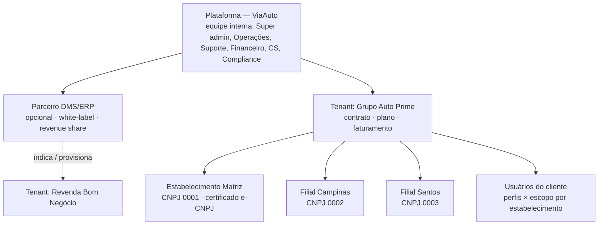
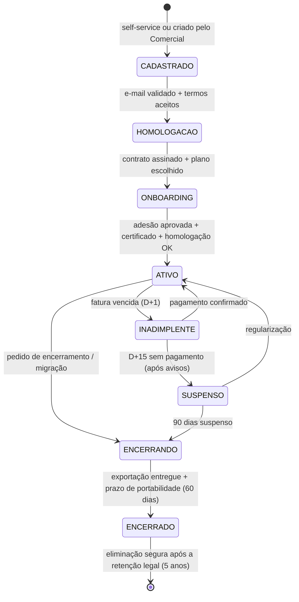

# 11 — Modelo SaaS: operação da plataforma, clientes, planos e cobrança

> O ViaAuto é um **SaaS B2B multi-tenant**. **Nós somos o operador da plataforma** (a integradora). Concessionárias, revendas, grupos, montadoras, ITEs e instituições credoras são **clientes (tenants)** e assinam o serviço, cada um com seus estabelecimentos (matriz e filiais) e usuários.
> Este documento especifica a camada SaaS: backoffice do operador, ciclo de vida do cliente, planos, cobrança, parceiros e a conta do cliente.

---

## 11.1 Hierarquia de contas

| Nível | Quem é | Isolamento | Exemplos de dados |
|---|---|---|---|
| **Plataforma** | Nós (operador) | Acesso cross-tenant **apenas** por papéis de plataforma, com auditoria | Planos, faixa de preço, flags, catálogo RENAVE, métricas globais |
| **Parceiro** | Fornecedor de DMS/ERP que integra via API e white-label | Vê apenas os tenants que indicou, com o consentimento deles | Clientes indicados, volume, comissão |
| **Tenant** | Cliente contratante (CNPJ raiz / grupo econômico) | **RLS** por `tenant_id` | Contrato, assinatura, faturas, usuários |
| **Estabelecimento** | CNPJ que opera no RENAVE (matriz/filial) | Escopo dentro do tenant | Certificado, estoque, operações |
| **Usuário** | Pessoa ou cliente de API | Perfil × escopo de estabelecimentos | — |

> Um usuário pode pertencer a **mais de um tenant** (ex.: contador ou despachante que atende várias revendas), com troca de contexto explícita e auditada.

## 11.2 Papéis da plataforma (equipe interna)

| Papel | Pode | Não pode | MFA |
|---|---|---|---|
| **Super admin** | Tudo na plataforma; gerenciar equipe e papéis; faixa de preço; flags globais | Ler dados de operação de cliente sem acesso de suporte registrado | Obrigatório (WebAuthn) |
| **Operações / NOC** | Saúde do conector, filas, reconciliação global, incidentes, reprocessamento seguro | Alterar plano ou cobrança | Obrigatório |
| **Suporte N1** | Ver cadastro e status dos clientes; abrir e responder chamados; **acessar como** (somente leitura, com motivo e prazo) | Executar operações RENAVE pelo cliente; exportar dados | Obrigatório |
| **Suporte N2** | O mesmo que o N1, mais reprocessamento controlado e diagnóstico técnico (payloads mascarados) | Alterar cobrança | Obrigatório |
| **Financeiro** | Planos, faturas, cobranças, régua de cobrança, NFS-e, suspensão por inadimplência | Ver dados de operação | Obrigatório |
| **Comercial / CS** | Criar cliente (provisionamento), acompanhar onboarding e saúde, parceiros | Cobrança, dados operacionais | Obrigatório |
| **Compliance / DPO** | Auditoria da plataforma, solicitações de titulares, exportações para fiscalização, retenção | Alterar dados | Obrigatório |

**Regras:**
- Acesso **just-in-time**: privilégios elevados são temporários, com aprovação.
- Revisão trimestral de acessos.
- Toda ação de plataforma gera um evento na **auditoria da plataforma** (cadeia de hash própria).

## 11.3 Ciclo de vida do cliente (tenant)

| Estado | O que o cliente pode fazer | Observações |
|---|---|---|
| CADASTRADO | Completar o cadastro | — |
| HOMOLOGACAO | Usar o ambiente de **homologação** (mocks e clientes-padrão), configurar usuários e estabelecimentos | *Trial* sem custo de operação real |
| ONBOARDING | Jornada de adesão (Credencia, certificado, homologação) | Acompanhada pelo CS |
| ATIVO | Tudo, conforme o tipo de estabelecimento | — |
| INADIMPLENTE | Tudo, com banner de aviso | Régua: D+1 lembrete, D+7 aviso formal |
| **SUSPENSO** | **Consultas, documentos, auditoria e exportação** continuam liberadas. **Novas operações** ficam bloqueadas, **exceto** cancelamentos e operações que evitem dano ao cliente (ex.: concluir saída já iniciada), conforme a política | Atraso de escrituração gera multa ao estabelecimento: a suspensão é **precedida de avisos** e o contrato prevê o efeito. Decisão final: jurídico (ver D9) |
| ENCERRANDO | Somente leitura + exportação completa | Portabilidade (Anexo Res. 1.026) |
| ENCERRADO | — | Dados retidos pelo prazo legal, depois eliminados com certificado |

## 11.4 Planos, preços e entitlements

### Restrições regulatórias que moldam a precificação (Res. 1.026, art. 32)

1. O valor cobrado pelos **serviços de integração ao RENAVE** precisa estar **dentro da faixa mínima e máxima** definida pela SENATRAN.
2. É **vedado** condicionar o acesso ao RENAVE à contratação de **outros serviços**.
3. Os preços precisam ter **ampla publicidade**, com acesso prévio.

### Modelo recomendado

> **Todas as operações RENAVE** exigidas pelo tipo de estabelecimento ficam disponíveis em **todos** os planos. Os planos se diferenciam por **serviços adicionais** fora do núcleo regulatório, contratáveis separadamente.

| Componente | Cobrança | Observação |
|---|---|---|
| **Núcleo RENAVE** (todas as operações do tipo de estabelecimento, pendências, auditoria, dossiê, portabilidade) | **Por operação confirmada** `[PREÇO dentro da FAIXA SENATRAN]` e/ou mensalidade por estabelecimento, conforme o ato da SENATRAN | Sem limite artificial de funcionalidade regulatória |
| Add-on **API e webhooks** (ERP/DMS) | Mensal por volume de chamadas | Opcional |
| Add-on **SSO corporativo + perfis customizados** | Mensal | Opcional |
| Add-on **Painel executivo multi-filial / BI** | Mensal | Opcional |
| Add-on **Suporte premium / SLA estendido / CSM dedicado** | Mensal | Opcional |
| Add-on **White-label** (parceiros) | Contrato de parceria | Opcional |

| Plano (sugestão) | Público | Inclui |
|---|---|---|
| **Essencial** | Revenda pequena (1 estabelecimento) | Núcleo RENAVE, até N usuários, suporte padrão |
| **Profissional** | Revenda média / concessionária | Núcleo + importação de NF-e, relatórios avançados, mais usuários |
| **Grupo** | Grupos com várias filiais | Núcleo + painel multi-filial, transferências entre filiais, SSO |
| **Enterprise / API** | Montadoras, grandes grupos, parceiros DMS | Núcleo + API e webhooks em volume, SLA dedicado, sandbox |

**Entitlements** ficam guardados por tenant (`tenant_entitlement`: recurso, limite, origem — plano ou add-on, vigência) e são avaliados no backend. As **flags regulatórias** (ex.: consignação ativa a partir da data de vigência) são independentes do plano.

### Validador de faixa

O cadastro de preços **rejeita** valores fora da faixa vigente (`price_band`: mínimo, máximo, ato normativo, vigência). Quando a faixa muda, o sistema lista os planos fora da nova faixa e bloqueia a publicação até o ajuste (RN-COB-01).

## 11.5 Medição de uso e cobrança

| Etapa | Regra |
|---|---|
| **Medição** | Um `usage_record` é criado **somente** quando a operação é **confirmada** pelo RENAVE, com chave idempotente `(operation_id, tipo)`, o que impede cobrança duplicada em retries e reconciliações |
| **Não cobrado** | Rejeições (422), erros técnicos, operações incertas não confirmadas, consultas de aptidão (configurável) e operações em homologação |
| **Fechamento** | Mensal por tenant, com detalhamento por estabelecimento e tipo de operação; prévia disponível em tempo real em "Minha assinatura" |
| **Faturamento** | Fatura + cobrança via gateway (boleto, PIX, cartão) + **NFS-e** automática |
| **Régua de cobrança** | D-3 lembrete · D+1 aviso · D+7 aviso formal (e-mail + WhatsApp + banner) · D+15 suspensão parcial (ver 11.3) |
| **Conciliação** | Uso faturável × custo SERPRO/SENATRAN por cliente (margem) |
| **Webhooks do gateway** | Assinados e idempotentes, com estados de pagamento refletidos na assinatura |
| **Transparência** | Tabela de preços pública; extrato de uso exportável; contestação de item de fatura |

## 11.6 Provisionamento de clientes

**Dois caminhos:**

1. **Self-service:** "Criar conta da empresa" com CNPJ, responsável (CPF), e-mail e tipo. Em seguida: validação de e-mail → ambiente de **homologação** liberado → escolha do plano → contrato eletrônico → onboarding regulatório (adesão, certificado, homologação) → produção.
2. **Assistido** (Comercial/CS no backoffice): assistente "Novo cliente" com empresa (CNPJ e CNAE), tipo e módulos, plano e faturamento, administrador do cliente (convite + MFA obrigatório) e ambiente inicial. O cliente recebe o convite e conclui o onboarding.

**Via parceiro (API de parceiro):** o DMS provisiona o cliente programaticamente, com **consentimento** registrado do cliente final, e opera via API e telas *embedded* com a marca do parceiro.

## 11.7 Acesso de suporte ("Acessar como")

- Exige **motivo** obrigatório (texto + chamado vinculado) e **duração máxima** (padrão: 60 min).
- É **somente leitura** por padrão; escrita exige aprovação do cliente ou de um supervisor e fica registrada.
- O **cliente é notificado** e vê o histórico de acessos de suporte em sua auditoria.
- Durante a sessão, um banner persistente mostra "Você está acessando como Auto Prime — somente leitura — expira em 42 min".
- Ações proibidas mesmo com aprovação: ver ou exportar a chave do certificado, alterar MFA do cliente, exportar dados pessoais em massa.

## 11.8 Parceiros DMS/ERP (canal B2B2B)

> A Res. 1.026 **proíbe** fornecedores de DMS/ERP de lojas e concessionárias de serem integradoras. Eles precisarão de uma integradora autorizada, e esse é o nosso canal.

| Capacidade | Descrição |
|---|---|
| Conta de parceiro | Organização de parceiro com usuários próprios, sandbox e chaves de API |
| Clientes indicados | Vínculo parceiro ↔ tenant com **consentimento** do tenant; o parceiro vê status e uso agregado, **não** dados de operação, salvo consentimento específico |
| White-label | Logo, cores e domínio do parceiro nas telas *embedded* e e-mails |
| Embedded | Componentes ou iframes autenticados (assistente de entrada, ficha do veículo) para incorporar no DMS |
| Revenue share | Percentual por cliente indicado, apurado mensalmente |
| Certificação | Programa de certificação técnica da integração do parceiro (testes de contrato) |

> ⚠️ O parceiro **não** pode operar o RENAVE em nome próprio nem ter acesso ao certificado do cliente. A integradora (nós) continua responsável perante a SENATRAN.

## 11.9 Métricas do SaaS (backoffice)

| Métrica | Definição |
|---|---|
| MRR / ARR | Receita recorrente mensal / anual (assinaturas + uso médio) |
| Clientes por estado | Homologação, onboarding, ativos, inadimplentes, suspensos, encerrados |
| Funil de onboarding | Cadastrado → Credencia → Certificado → Homologação → Produção, com tempo médio por etapa |
| Operações faturáveis | Volume confirmado no mês, por tipo e por cliente |
| NRR / churn | Retenção líquida de receita / cancelamentos |
| Health score do cliente | Pendências vencidas, incertos, certificado, uso, chamados, inadimplência |
| Margem por cliente | Receita − custo SERPRO − custo de infraestrutura rateado |
| Parceiros | Clientes indicados, volume, comissão |

## 11.10 Requisitos funcionais da camada SaaS

### M21 — Backoffice do operador (gestão do SaaS)

| ID | Requisito | Prio | Fase |
|---|---|---|---|
| RF-M21-01 | Visão geral do SaaS: MRR, clientes por estado, operações faturáveis, funil de onboarding, alertas, top clientes | M | F3 |
| RF-M21-02 | Lista de clientes com filtros (plano, estado, tipo, CSM, saúde) e busca por CNPJ ou nome | M | F1 |
| RF-M21-03 | Detalhe do cliente com abas: visão geral, estabelecimentos, usuários, assinatura e faturas, uso, módulos e limites, suporte, auditoria | M | F1 |
| RF-M21-04 | Assistente "Novo cliente" (provisionamento assistido) com convite do administrador | M | F1 |
| RF-M21-05 | Suspender, reativar e encerrar cliente, com motivo e efeitos explicados; exportação de portabilidade | M | F1 |
| RF-M21-06 | "Acessar como" auditado (motivo, prazo, somente leitura, notificação) | M | F2 |
| RF-M21-07 | Gestão da equipe da plataforma: papéis, MFA obrigatório, acessos temporários, revisão de acessos | M | F1 |
| RF-M21-08 | Auditoria da plataforma (impersonações, planos, suspensões, exportações, faixa de preço) com cadeia de hash | M | F1 |
| RF-M21-09 | Configurações globais: faixa de preço SENATRAN, feature flags (por tenant, ambiente e data), integrações da plataforma, templates, retenção | M | F1 |
| RF-M21-10 | Central de suporte multi-tenant com SLA e contexto automático da operação | M | F2 |
| RF-M21-11 | Health score do cliente e alertas para o CS | S | F3 |
| RF-M21-12 | Anúncios e comunicados para clientes (in-app + e-mail), segmentados (ex.: mudança de manual RENAVE) | S | F3 |

### M22 — Assinaturas e cobrança

| ID | Requisito | Prio | Fase |
|---|---|---|---|
| RF-M22-01 | Catálogo de planos e add-ons com entitlements e limites | M | F3 |
| RF-M22-02 | Validador de faixa de preço SENATRAN e tabela pública de preços gerada automaticamente | M | F3 |
| RF-M22-03 | Medição idempotente de uso por operação confirmada | M | F2 |
| RF-M22-04 | Fechamento mensal, fatura, cobrança via gateway (boleto, PIX, cartão) e NFS-e | M | F3 |
| RF-M22-05 | Régua de cobrança configurável e suspensão parcial automática | M | F3 |
| RF-M22-06 | Webhooks do gateway de pagamento (idempotentes) e conciliação | M | F3 |
| RF-M22-07 | Upgrade, downgrade e add-ons com pró-rata | S | F3 |
| RF-M22-08 | Conciliação uso × custo SERPRO e margem por cliente | S | F3 |
| RF-M22-09 | Contestação de item de fatura pelo cliente | C | F3 |

### M23 — Conta do cliente (autoatendimento)

| ID | Requisito | Prio | Fase |
|---|---|---|---|
| RF-M23-01 | Cadastro self-service da empresa com validação de CNPJ e e-mail, aceite de termos e ambiente de homologação | M | F2 |
| RF-M23-02 | "Minha assinatura": plano, uso em tempo real por tipo e estabelecimento, previsão de fatura, faturas e 2ª via, forma de pagamento | M | F3 |
| RF-M23-03 | Mudar de plano e contratar ou cancelar add-ons | S | F3 |
| RF-M23-04 | Exportar todos os dados (portabilidade) a qualquer momento | M | F3 |
| RF-M23-05 | Histórico de acessos de suporte à conta | M | F2 |
| RF-M23-06 | Encerrar conta com assistente (exportação + confirmação) | S | F3 |

### M24 — Parceiros

| ID | Requisito | Prio | Fase |
|---|---|---|---|
| RF-M24-01 | Cadastro de parceiro com sandbox, chaves de API e documentação | S | F3 |
| RF-M24-02 | Provisionamento de clientes via API de parceiro, com consentimento | S | F3 |
| RF-M24-03 | White-label (logo, cores, domínio) e componentes *embedded* | C | F4 |
| RF-M24-04 | Apuração de revenue share e relatório ao parceiro | C | F4 |

## 11.11 Regras de negócio da camada SaaS

| ID | Regra | Sev. | Origem |
|---|---|---|---|
| RN-SAAS-01 | Toda leitura cross-tenant por papel de plataforma exige motivo registrado. Dashboards agregados não expõem dados pessoais | 🔴 | LGPD, PROD |
| RN-SAAS-02 | Funcionalidades regulatórias do RENAVE **não** são bloqueadas por plano (art. 32 §3º) | 🔴 | RES art. 32 |
| RN-SAAS-03 | Preço publicado sempre dentro da faixa vigente; mudança de faixa bloqueia a publicação até o ajuste | 🔴 | RES art. 32 |
| RN-SAAS-04 | Uso cobrado só para operação **confirmada**, com idempotência por operação | 🔴 | PROD |
| RN-SAAS-05 | Suspensão por inadimplência só após a régua completa de avisos; consultas e exportação continuam disponíveis | 🔴 | PROD, ANEXO |
| RN-SAAS-06 | Encerramento garante exportação íntegra e verificável e prazo de portabilidade de 60 dias; eliminação só após a retenção legal | 🔴 | ANEXO |
| RN-SAAS-07 | Acesso de suporte é temporário, auditado, somente leitura por padrão e visível ao cliente | 🔴 | PROD, ISO 27001 |
| RN-SAAS-08 | O certificado e a chave do cliente **nunca** ficam acessíveis a papéis de plataforma nem a parceiros | 🔴 | RES art. 30, ANEXO |
| RN-SAAS-09 | Parceiro vê apenas os clientes que indicou, com consentimento, e dados agregados por padrão | 🔴 | LGPD |
| RN-SAAS-10 | Homologação (trial) não gera cobrança de operação nem toca a produção | 🔵 | PROD |
| RN-SAAS-11 | Usuário com acesso a vários tenants troca de contexto explicitamente; cada ação registra o tenant ativo | 🔴 | PROD |

## 11.12 Modelo de dados adicional (camada SaaS)

| Entidade | Campos principais |
|---|---|
| `platform_user` / `platform_role_grant` | Usuário interno, papel, escopo, expira_em (JIT), aprovado_por |
| `tenant` (estendido) | estado do ciclo de vida, plano_atual, csm_id, parceiro_id, health_score, datas (trial, ativação, suspensão, encerramento) |
| `plan` / `plan_version` / `addon` | Código, nome, preços (por operação e mensalidade), entitlements, vigência, publicado |
| `price_band` | Mínimo, máximo, ato normativo, vigência |
| `subscription` | tenant, plano, add-ons, ciclo, status, início, renovação, gateway_ref |
| `tenant_entitlement` | Recurso, limite, origem, vigência |
| `usage_record` | tenant, estabelecimento, operation_id (unique), tipo, quantidade, preço unitário, competência |
| `invoice_saas` / `payment` / `nfse` | Fatura, itens, valor, vencimento, status, gateway_ref, NFS-e |
| `dunning_event` | Fatura, etapa, canal, enviado_em |
| `support_access` | Usuário de plataforma, tenant, motivo, chamado, modo (leitura/escrita), início, fim, aprovado_por |
| `partner` / `partner_tenant` | Parceiro, white-label, chaves; vínculo com consentimento, revenue share |
| `platform_audit_event` | Igual a `audit_event`, com cadeia própria |
| `announcement` | Segmento, conteúdo, canal, publicado_em |

## 11.13 Telas do protótipo (camada SaaS)

As telas estão no mesmo canvas do protótipo, nas páginas **"Gestão do SaaS (Backoffice)"** e **"Conta do cliente"**: https://claude.ai/artifact/HdnUJ7n2pbz9pZY9hD71gN

| Tela | Artboard |
|---|---|
| Visão geral do SaaS | `SaasVisaoGeral` |
| Clientes (tenants) | `SaasClientes` |
| Detalhe do cliente (abas + "Acessar como") | `SaasClienteDetalhe` |
| Novo cliente (provisionamento) | `SaasNovoCliente` |
| Planos e preços (validador de faixa) | `SaasPlanos` |
| Faturamento e régua de cobrança | `SaasFaturamento` |
| Parceiros DMS/ERP | `SaasParceiros` |
| Suporte multi-tenant | `SaasSuporte` |
| Equipe da plataforma | `SaasEquipe` |
| Auditoria da plataforma | `SaasAuditoria` |
| Configurações globais | `SaasConfig` |
| Operação técnica | `Console` |
| Minha assinatura (cliente) | `MinhaAssinatura` |
| Cadastro self-service | `Cadastro` |

## 11.14 Reuso dos projetos com modelo SaaS

> Projetos analisados (somente leitura): **baconian**, **kitara-ead**, **incentivatech** e **despachante**. `mirandaserp` (fork do ERPNext) e `vestigio-lab` (laboratório Python) foram descartados como base SaaS.
> Legenda: 🟢 COPIAR · 🟡 ADAPTAR · 🔵 IDEIA · ⚪ NÃO SERVE.

### Panorama

| Projeto | Stack | Maturidade SaaS | Melhor contribuição |
|---|---|---|---|
| **baconian** | Next 16 + pacotes TS independentes (`packages/{db,identity,billing,observability,storage}`), Prisma 7, BullMQ | **Alta no núcleo**: isolamento verificável, billing Asaas robusto, ledger idempotente, auditoria append-only, LGPD | **Base de pacotes** da camada SaaS (portáveis para Fastify) |
| **kitara-ead** | Next 16 monolítico, Prisma 7, Tailwind 4 | **Alta no backoffice**: sessão de suporte auditada, régua de cobrança, métricas MRR/NRR/churn, entitlements por módulo, contratos com hash, saúde do tenant | **Regras puras de operação do SaaS** e fluxos das telas |
| **incentivatech** | Fastify 5 + React 19/Vite 8/Tailwind 4 (**mesma stack-alvo**) | Média: portal admin SaaS, trial, assentos, gate 402, cobrança Asaas | **UI do backoffice e da tela de cobrança do cliente** |
| **despachante** | Fastify 5 + Prisma 6 + Next | Média: `PLATFORM_ADMIN`, escopos concedidos por organização, Asaas com webhook idempotente, termos versionados | **Esqueleto da API**, cliente e webhook Asaas, escopos concedidos |

### Matriz de reuso — camada SaaS

| Tema | Origem | Classe | Como usar no ViaAuto |
|---|---|---|---|
| Escopo obrigatório de tenant na aplicação (extensão Prisma que injeta e confere o tenant; falha se a consulta vier sem escopo) | `baconian/packages/db/src/scoped.ts` | 🟢 | Primeira barreira; **RLS por cima** (doc 02, `withTenantTransaction`) |
| FKs compostas `(tenant_id, id)` + check de CI de colunas de tenant | `baconian/packages/db` (convenções do schema), `scripts/check-tenant-columns.ts` | 🟢 | Integridade cross-tenant no banco |
| Rotas declaradas com escopo (`public / user / tenant / platform`) + manifesto + build que quebra se faltar teste | `baconian` (`defineRoute`, `tests/security/rotas-sem-workspace.ts`) | 🟡 | Reescrever como plugin Fastify |
| Suíte de segurança cross-tenant contra **Postgres real** com dois tenants; negar com **404** | `baconian/apps/web/tests/security/helpers/two-workspaces.ts`, `identity/src/acesso.ts` | 🟡 | Gate de CI (SEC-05) |
| Papéis do tenant mapeados para permissões | `baconian/packages/identity/src/papeis.ts` | 🟡 | Perfis do doc 03 com escopo por estabelecimento |
| Convites com token hash, expiração, revogação, reenvio e limite de plano | `baconian/packages/identity/src/convites.ts` | 🟢 | Convite do admin do cliente e da equipe |
| Admin de plataforma com MFA obrigatória | `baconian/.../platform-admin.ts`, `mfa.ts` | 🟡 | Virar claims do Keycloak + papéis de plataforma (11.2) |
| **Delegação de suporte** concedida pelo cliente (escopo + expiração) | `baconian` (`SupportDelegation`, `ActorType SUPPORT`) | 🟡 | Consentimento do "Acessar como" |
| **Sessão de suporte auditada** (motivo, 15/30/60 min, token de uso único, **somente leitura imposto no servidor**, log de páginas, encerramento remoto) | `kitara-ead/src/lib/sessao-suporte*.ts` + modelos `SessaoSuporte*` | 🟢 (regras) | "Acessar como" (11.7) como hook `onRequest` no Fastify + claim `act` no token |
| `Plan` **versionado** + `Subscription` (próximo plano, cancelar no fim do ciclo, carência, chave idempotente) + entitlements | `baconian/packages/billing` (`catalog.ts`, `entitlements.ts`, `assinaturas.ts`) | 🟢 | Planos, add-ons e entitlements (11.4) |
| Entitlement por módulo com override por tenant | `kitara-ead/src/lib/modulos-ga*.ts` | 🟡 | `tenant_entitlement` |
| Escopos de integração concedidos pela plataforma, com diff e `grantedBy` | `despachante/apps/api/src/routes/v1/platform-detran-scopes.ts` | 🟢 | Habilitar módulos regulatórios (0 km, ITE, consignação) por cliente |
| **Ledger idempotente** (reserva, captura, estorno, unicidade por chave, débito condicional, teste de concorrência) | `baconian/packages/billing/src/ledger.ts` + testes | 🟢 | `usage_record` por operação RENAVE confirmada (RN-SAAS-04) |
| Billing Asaas: evento persistido **antes** de processar, correlação de webhook, `CheckoutAttempt` com estado incerto, reconciliação diária, gateway simulado | `baconian/packages/billing` (`asaas/*`, `eventos.ts`, `correlacao-webhook.ts`) | 🟢 | Núcleo de cobrança (11.5) |
| Cliente Asaas com modo mock + webhook com comparação em tempo constante e upsert idempotente | `despachante/apps/api/src/lib/asaas/*`, `routes/v1/webhooks-asaas.ts` | 🟢 | Complementa o anterior no esqueleto Fastify |
| **Régua de cobrança** pura e testada (D+3/7/10/15) e suspensão/reativação com auditoria | `kitara-ead/src/lib/dunning-regua.ts` (+ teste), `dunning.ts` | 🟢 / 🟡 | Régua (11.5) com **suspensão parcial** (11.3), via fila |
| Fechamento de ciclo (carência → bloqueio) | `baconian` (`fecharCiclosDeAssinatura`) | 🟡 | Inadimplência bloqueia novas operações, não "volta para o free" |
| Dupla aprovação para reembolso e ajuste | `baconian` (`reembolsos.ts`, `ajustes-de-credito.ts`) | 🟢 | Controle financeiro do operador |
| **Métricas de receita** (ponte de MRR: nova, expansão, redução, churn; NRR, ARPU, aging) | `kitara-ead/src/lib/metricas-receita-saas.ts` (+ teste) | 🟢 | Visão geral do SaaS (11.9) |
| Saúde e onboarding do tenant; caixa de trabalho priorizada do backoffice | `kitara-ead/src/lib/tenant-admin-lista.ts`, `caixa-trabalho-saas.ts` | 🟡 | Health score e fila do CS |
| Confirmação de configuração crítica (frase + diff) | `kitara-ead/src/lib/configuracoes-criticas.ts` | 🟢 | Faixa de preço, flags globais, suspensão |
| Self-service: tenant criado inativo até a 1ª etapa concluída; trial prorrogável | `kitara-ead/src/lib/onboarding-saas.ts`, `tenant-contract-trial.ts`; `incentivatech` (signup em TRIAL) | 🟡 | Cadastro → homologação (11.6) |
| Contratos SaaS com modelo e **aceite com hash** | `kitara-ead` (`ModeloContratoSaaS`, `TenantContrato`) | 🟡 | Contrato eletrônico do cliente |
| Termos versionados com aceite, IP e data | `despachante` (`TermsVersion`, `TermsAcceptance`, `platform-terms.ts`) | 🟢 | RF-M1-08 |
| Auditoria append-only com severidade e delegação; logger com redação; métricas Prometheus | `baconian/packages/observability` | 🟢 | Auditoria da plataforma; somar cadeia de hash (doc 02) |
| Exportar tudo + exclusão de conta com carência e purga | `baconian` (`AccountDeletion`, export) | 🟡 | Portabilidade e encerramento, com retenção legal de 5 anos |
| Storage S3 agnóstico | `baconian/packages/storage` | 🟢 | Região Brasil, SHA-256 |
| Kit UI do admin (DataTable, Drawer, KpiCard, PageHeader, StatusPill, Tabs, Toast, Pagination, Skeleton, ExportButton) | `incentivatech/apps/web/src/components/admin/*` | 🟡 | Backoffice (já em React/Vite/Tailwind 4) |
| Telas Empresas/Financeiro do admin; tela de cobrança do cliente (`BillingPage`, `ChangePlanModal`, `PlanComparison`, `PaymentMethodSection`) | `incentivatech/apps/web/src/pages/admin-platform/*`, `BillingPage` | 🟡 | `SaasClientes`, `SaasFaturamento`, `MinhaAssinatura` |
| Fluxos das telas do super-admin (tenants com saúde, planos, faturas, métricas, logs, suporte, comunicação em massa, pipeline comercial) | `kitara-ead/src/app/dashboard/*` | 🔵 | Referência de fluxo; **reescrever** em componentes pequenos |
| Gate de assinatura com HTTP 402 | `incentivatech/apps/api/src/plugins/subscription-gate.ts` | 🔵 | Contrato 402 bom; cache precisa ser distribuído |
| Tipo de organização (empresa / publicador / órgão) | `incentivatech` (`OrganizationType`) | 🔵 | Tipos: revenda, concessionária, montadora, ITE, credora, parceiro |
| Branding por organização / white-label | `kitara-ead` (cores, logo, domínio), `incentivatech` (branding de publicador) | 🔵 | Parceiros DMS (11.8) |
| Resolução de tenant por host no proxy do Next; tenant com dezenas de colunas de domínio; hard delete de tenant; plano como texto livre; MRR "estimado" por valor fixo | vários | ⚪ | Substituídos pelas decisões deste documento |

### Lacunas comuns (construir do zero)

- **RLS no Postgres.** Nenhum dos quatro tem; o padrão vem da `plataforma-harmonizacao-normativa` (doc 02).
- **Hierarquia matriz/filial** com estabelecimentos por CNPJ. Base: `organization_establishment` da harmonização.
- **Papéis de plataforma granulares** (suporte, financeiro, CS, compliance) e acesso JIT.
- **NFS-e** (avaliar a emissão nativa do gateway).
- **Faixa de preço regulatória** e o validador.

### Ordem de porte recomendada

1. `baconian/packages/db` (escopo + FKs compostas + check de CI) **+ RLS** (harmonização) + `organization`/`establishment` com matriz/filial.
2. `baconian/packages/observability` (auditoria append-only, logger com redação, métricas) **+ cadeia de hash** e NTP do Observatório Nacional.
3. `baconian/packages/identity` (papéis, acesso 404, convites, MFA) sobre **Keycloak**, com papéis de plataforma e delegação de suporte + regras da sessão de suporte do `kitara-ead`.
4. `baconian/packages/billing` (planos versionados, assinaturas, ledger, Asaas, eventos, reconciliação, dupla aprovação) + régua do `kitara-ead` + cliente e webhook do `despachante` + **NFS-e** + validador de faixa SENATRAN.
5. Padrão `defineRoute` + suíte cross-tenant (dois tenants em Postgres real) como plugin Fastify.
6. UI: kit admin e telas de cobrança do `incentivatech`, fluxos do `kitara-ead`, design system "Clean Operacional" (doc 08) e métricas de receita do `kitara-ead`.

> **Importante:** este repositório é **público**. O código portado de repositórios privados só deve entrar depois de decidir a visibilidade do repositório e de uma **revisão de segurança** de cada arquivo, sem segredos, sem dados de clientes e com as dívidas listadas no doc 02 §2.5 corrigidas. Registrar a proveniência num `NOTICE.md`, como o `baconian` já faz.
