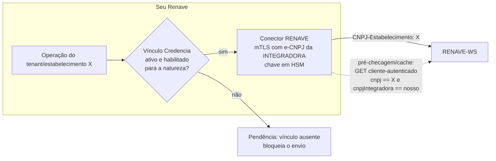

# 14 — Integração com o SERPRO (RENAVE-WS) no modelo de integradora

> Situação em 23/11/2026. Fontes: Swagger de produção e de homologação (baixados e comparados), manual RENAVE-WS, Central de Ajuda, Loja SERPRO, bundle público do Credencia, release SERPRO de 13/11/2026, Portaria SENATRAN 417/2026 e Res. CONTRAN 1.026/2026.
> **Rótulos:** **[OF]** oficial · **[TESTE]** verificado por chamada real em homologação · **[INF]** inferência.

---

## 14.1 Modelo de acesso: integradora com certificado próprio + cabeçalho do estabelecimento

| Aspecto | Modelo **anterior** (manual de produção) | Modelo **novo** (homologação, Res. 1.026) |
|---|---|---|
| Certificado mTLS | e-CNPJ **de cada estabelecimento**, cadastrado no Credencia | e-CNPJ **da integradora**: uma conexão para todos os clientes [OF/TESTE] |
| Identificação do cliente | Pelo próprio certificado | Cabeçalho HTTP **`CNPJ-Estabelecimento: <cnpj>`** em todas as operações dos grupos Estabelecimento, ITE e Montadora [OF] (`securityDefinitions.cnpjEstabelecimento`, `in: header`) |
| Autorização | Certificado habilitado no Credencia | **Vínculo** loja → integradora no **Credencia** ("Vincular Integradoras"), por natureza de serviço, com "de acordo" da loja e habilitação pelo órgão: a **procuração eletrônica** [OF] |
| Certificado da loja | Entregue à integradora | **Não precisa mais**: "Não vai precisar mais a loja passar o seu certificado digital para a integradora" (SERPRO, 13/11/2026) [OF] |
| `GET /api/cliente-autenticado` | `cnpj`, `nome`, `endereco` | Também traz **`cnpjIntegradora`** e **`nomeIntegradora`** [OF] |
| Lojas com várias integradoras | — | Permitido: "pode trabalhar com mais de um ao mesmo tempo" [OF] |

**Teste em homologação** (23/11/2026, cliente-padrão, sem certificado) [TESTE]:
- `GET /api/cliente-autenticado` **sem** o cabeçalho → `cnpjIntegradora: null`.
- **Com** `CNPJ-Estabelecimento: 85106037000585` → `cnpjIntegradora: 69418503000188`, `nomeIntegradora: "Integradora Padrao"`. O mesmo vale para ITE (58900504000148) e Montadora (11552671000181).
- ⚠️ Com um CNPJ **não vinculado**, o cabeçalho é **ignorado em silêncio**: a resposta volta como o cliente-padrão, **sem erro**. Em produção, isso poderia levar a **registro no CNPJ errado**. Daí a regra RN-INT-SRP-03.

**Em produção** o Swagger **ainda não** tem o cabeçalho nem os campos de integradora. A data de ativação não foi confirmada.

## 14.2 Arquitetura do conector (revisada)

**Modos suportados** (feature flag por ambiente e estabelecimento):
1. **`INTEGRADORA`** (padrão do novo modelo): certificado da integradora + cabeçalho `CNPJ-Estabelecimento`.
2. **`ESTABELECIMENTO`** (legado/fallback): certificado do próprio estabelecimento, enquanto a produção não ativar o novo modelo, ou em migração.

**Consequências:**
- O **certificado crítico** passa a ser **o da integradora**: um único ponto de falha. Ele vai para HSM, com **redundância (2 certificados válidos com rotação escalonada)**, monitoramento 24×7 e alerta de vencimento.
- Pelo art. 30, certificado vencido ou revogado **bloqueia automaticamente** o acesso: **todos os clientes param**.
- O inventário de certificados **por estabelecimento** deixa de ser obrigatório. Fica como opção para o modo legado.
- Toda chamada registra na auditoria o `CNPJ-Estabelecimento` enviado e o `cnpj` / `cnpjIntegradora` confirmados.

## 14.3 Regras de integração SERPRO

| ID | Regra | Sev. |
|---|---|---|
| RN-INT-SRP-01 | Toda chamada aos grupos Estabelecimento, ITE e Montadora leva o cabeçalho `CNPJ-Estabelecimento` com o CNPJ do estabelecimento da operação. Ele vem do contexto do servidor, nunca do cliente | 🔴 |
| RN-INT-SRP-02 | Nenhuma operação é enviada sem **vínculo Credencia ativo e habilitado** para a natureza correspondente (Concessionário/Lojista, ITE, Montadora/Venda direta) | 🔴 |
| RN-INT-SRP-03 | Antes da primeira operação do dia por estabelecimento (cache de 1h e invalidação em erro), chamar `GET /api/cliente-autenticado` e confirmar que **`cnpj` = estabelecimento** e **`cnpjIntegradora` = nosso CNPJ**. Divergência **bloqueia** as operações e abre incidente (proteção contra o "ignorado em silêncio") | 🔴 |
| RN-INT-SRP-04 | Os campos marcados como `required` no Swagger de homologação são obrigatórios na nossa validação: `cpfOperadorResponsavel` em todos os POST, `emailEstabelecimento` e `emailVendedor`, `chaveNotaFiscal` na entrada e saída de 0 km, nome, e-mail e endereço completo do comprador, placa | 🔴 |
| RN-INT-SRP-05 | O certificado da integradora fica em HSM, com dois certificados válidos (rotação escalonada), alertas em 90/60/30/15/7 dias e teste diário de handshake | 🔴 |
| RN-INT-SRP-06 | **Monitor diário** dos `swagger-resources` e dos `api-docs` de produção e homologação e das páginas do manual, com *diff* automático e alerta. O RENAVE-WS **não tem changelog** nem versionamento | 🔴 |
| RN-INT-SRP-07 | Timeouts: POST 120 s, GET 60 s. Erro com `{titulo, dataHora, detalhe, mensagemParaUsuarioFinal, logIdRastreabilidade}` guardado integralmente; 500 → reconciliação + chamado SERPRO com o `logIdRastreabilidade` | 🔴 |

## 14.4 Diferenças entre produção e homologação (23/11/2026)

| Item | Produção | Homologação |
|---|---|---|
| Grupos do Swagger | Estabelecimento, ITE, Montadora, Detran | Os mesmos + "Estabelecimento/ITE/Montadora – Homologação" (mocks). **Não existe** grupo "Integradora" |
| Operações do grupo Estabelecimento | 47 | 49 (+ consignação) |
| Cabeçalho `CNPJ-Estabelecimento` | Ausente | Em todas as operações (exceto grupo Detran) |
| `cnpjIntegradora` / `nomeIntegradora` | Ausente | Presente em `cliente-autenticado` |
| **Consignação** | — | `POST /api/consignados/solicitacao-entrada` (201, estado sempre CONFIRMADO, com `consignante`) e `POST /api/consignados/cancelamento`; `EstoqueJson.estoqueConsignado`; NF-e com `evento` `CONSIGNACAO` e `DEVOLUCAO`; mocks TR 231, 233, 203/227/237 (mesma UF) e 204 (outra UF, depende do DETRAN). Release SERPRO: fluxo "ainda informativo", liberado em 10/11 |
| Obrigatoriedade de campos | Mais frouxa | Vários campos passaram a `required` (RN-INT-SRP-04) |
| Manual | 73 páginas, sem changelog | Igual, com uma lista extra de impedimentos à entrada |

**Ainda sem endpoint**, em produção e em homologação: identificação prévia de entrada, estoque vinculado / garantias / retomados, termos de entrega com assinatura do proprietário, contrato eletrônico de consignação e assinatura do consignante, transferência eletrônica da Res. 1.027. Ficam como *adapters* reservados com feature flag (doc 07 §7.6.5).

## 14.5 Contratação e cobrança SERPRO

| Item | Situação |
|---|---|
| **Tarifa** | **R$ 5,48 por entrada ou saída no estoque** (Portaria SENATRAN 417/2026; Loja SERPRO). Sem franquia, pacote ou mensalidade publicados. Reajuste anual pelo IPCA [OF] |
| **O que é faturável pelo SERPRO** | Só "Registro de Entrada ou Saída de Veículo do Estoque" [OF]. Consultas, ATPV, NF, autorizações e cancelamentos não aparecem na tabela [INF]. Transferência entre estabelecimentos tende a gerar saída na origem + entrada no destino [INF] |
| **Competência de medição** | Do dia **21 ao dia 20** [OF — aviso da Central de Ajuda] |
| **Quem contrata o SERPRO no novo modelo** | **Não confirmado.** A página gov.br (dez/2025) ainda indica o **estabelecimento** como contratante. O Credencia tem um "itemFaturador" por natureza. A Loja não tem perfil "Integradora". [INF] a loja provavelmente segue contratante e pagadora do SERPRO |
| **API de consumo** | Não encontrada; o consumo deve aparecer na Área do Cliente SERPRO [INF] |
| **Preço da integradora** | Faixa da SENATRAN (art. 32), **não publicada** (doc 13) |

**Implicação no faturamento do Seu Renave** (doc 11 §11.4a):
- Um item faturável por **entrada ou saída confirmada**, alinhado à unidade do SERPRO e à competência 21→20, para facilitar a conciliação.
- Reenvio idempotente e cancelamento **não** são cobrados até confirmação oficial.
- Se a loja for a contratante do SERPRO, a fatura do Seu Renave traz **só o preço de integração**. Se formos nós, discrimina o repasse da tarifa.

## 14.6 Credencia para integradoras

Funções identificadas no bundle público do Credencia (`credencia.serpro.gov.br`) [OF]:
- solicitação de credenciamento na natureza **"Integradora"**, com análise manual pela SENATRAN e processo SEI;
- **"Gerenciar Entidades Integradas Vinculadas à Integradora"**: confirmar ou rejeitar vínculo, ativar/desativar, habilitar/desabilitar;
- **"Serviços/Naturezas Integradas Permitidas"**: "a liberação da operação de serviços/naturezas integradas é realizada pelo órgão competente".

**Fluxo provável [INF]:**
1. A loja abre "Vincular Integradoras" e escolhe a natureza e a integradora.
2. A loja dá o "de acordo".
3. A integradora confirma.
4. O órgão habilita.
5. A operação é liberada.

**No Seu Renave:**
- **RF-SRP-01:** cadastro e acompanhamento do **estado do vínculo Credencia** por estabelecimento e natureza: pendente, confirmado, habilitado, desativado, rejeitado. Não há API pública do Credencia; o estado é **informado e verificado** pela chamada a `cliente-autenticado`.
- **RF-SRP-02:** **guia passo a passo** no onboarding, para a loja vincular o Seu Renave no Credencia (substitui a etapa "enviar certificado").
- **RF-SRP-03:** console da integradora com a fila de **vínculos pendentes de confirmação**.

## 14.7 Contatos e canais oficiais

| Canal | Uso |
|---|---|
| Central de Serviços SERPRO: css.serpro@serpro.gov.br · 0800 728 2323 | Suporte técnico RENAVE-WS (500 com `logIdRastreabilidade`) |
| comercial@serpro.gov.br | Contratação, tarifa, faturamento |
| cgsie@transportes.gov.br | Credencia / SENATRAN |
| Formulário de homologação: https://form.omni.serpro.gov.br/?codigo=3192 | Pedidos de homologação "sob demanda" (ex.: veículo de teste criado pelo DETRAN) |

## 14.8 Perguntas formais a enviar na Fase 0 (SERPRO e SENATRAN)

1. Data de ativação, em **produção**, do cabeçalho `CNPJ-Estabelecimento` e do vínculo por procuração eletrônica.
2. Comportamento em produção quando o CNPJ não está vinculado: erro (esperado) ou fallback silencioso (como em homologação).
3. Quem é o **contratante e pagador** da tarifa SERPRO (R$ 5,48) no novo modelo: estabelecimento ou integradora? Existe produto "Integradora" na Loja?
4. Unidade de cobrança: por **movimento** ou por **veículo**? Transferências e cancelamentos são faturados?
5. Existe **API ou relatório de consumo** por estabelecimento para conciliação?
6. Roteiro oficial de **homologação do sistema de integração** (art. 3º VI) e cenários obrigatórios.
7. Cronograma dos endpoints de identificação prévia, termos de entrega, estoque vinculado/retomados, contrato de consignação e transferência eletrônica.
8. SLA e disponibilidade do RENAVE-WS; limites de requisição.
9. Ato da SENATRAN com a **faixa de preço da integradora** (art. 32): previsão e formato (por operação?).
